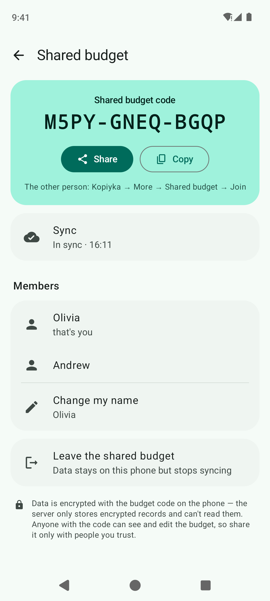
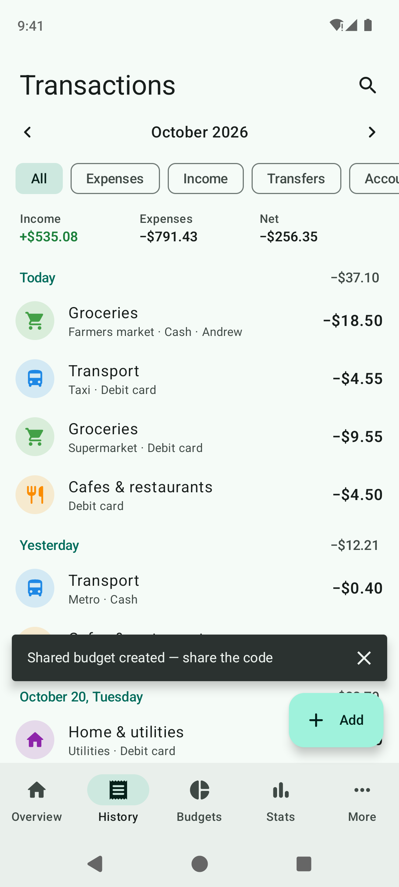
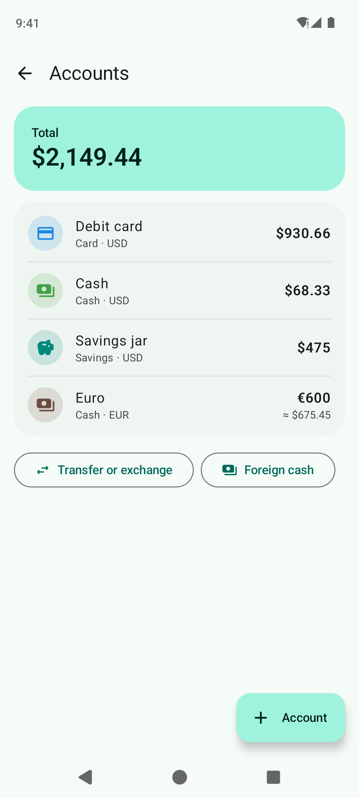
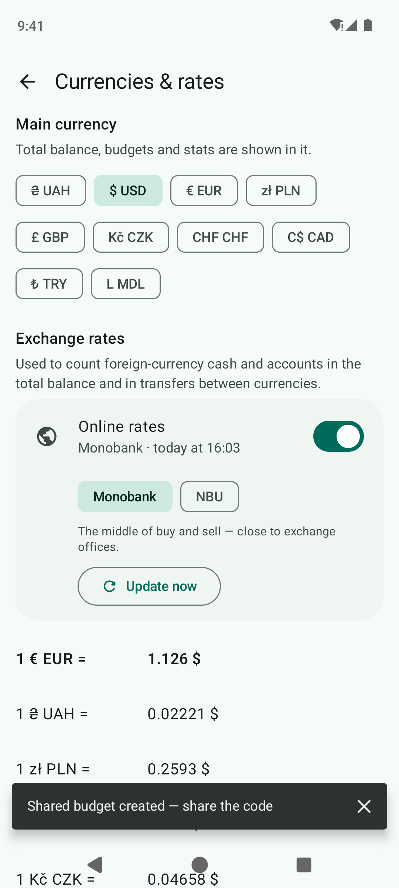

<p align="center">
  
</p>

<p align="center">
  <a href="https://github.com/hatogg/Kopiyka/releases/latest"></a>
  <a href="https://github.com/hatogg/Kopiyka/actions/workflows/build.yml"></a>
  
  
  <a href="LICENSE"></a>
</p>

<p align="center"><a href="README.md">Українська</a> &nbsp;|&nbsp; <b>English</b></p>

**Kopiyka** ("kopek", the Ukrainian penny) is an expense and income planner for Android. Log a purchase in three taps, keep money in several accounts and currencies, set a monthly budget and Kopiyka tells you every day how much you can still spend. Recurring payments record themselves, goals show how much to put aside, and charts show where the money really goes. You can keep a budget **together** — as a couple or a whole family, with a code. No ads, no sign-up.

<p align="center">
  <a href="https://github.com/hatogg/Kopiyka/releases/latest"></a>
</p>

<p align="center">
  
  
  
  
</p>
<p align="center">
  
  
  
  
</p>
<p align="center">
  
  
  
  
</p>

<sub>Real screenshots: GitHub Actions runs the app in an Android 14 emulator and walks through the screens with demo data.</sub>

## Features

| | |
| --- | --- |
| ⚡ **Fast entry** | A big calculator keypad: type "25+8" and get 33. Your most-used categories come first. Date, account and note are one tap away. |
| 👫 **Shared budget** | Create a budget and give the code to someone (e.g. `7KQ2-M9PA-X4TB`) — you both see and add the same transactions, accounts, budgets and goals. Changes show up on the other phone within a second, and each transaction shows who added it. Offline changes wait and are sent later. Data is encrypted with the code on the phone. |
| 💳 **Accounts & currencies** | Cards, cash, a savings jar, a deposit — in hryvnias, dollars, euros, zlotys and more. **Foreign cash** with an online rate to the hryvnia (Monobank or NBU): "$600 ≈ ₴26,900". Transfers between accounts, including currency exchange. The total balance is shown in your main currency. |
| 🎯 **Budgets** | An overall monthly limit plus limits for groceries, cafes, fun. "You can still spend $16 today", an end-of-month forecast and alerts at 80 % and 100 %. The month can start on payday. |
| 🔁 **Recurring payments** | Rent, utilities, subscriptions, salary: daily, weekly, monthly, yearly or every N. They record themselves, or remind you so you tap "Pay". |
| 🐷 **Savings goals** | A trip, a laptop, an emergency fund: progress, a deadline and how much to save each month. A goal can follow the balance of a savings account. |
| 📊 **Statistics** | A category donut, six months of income vs expenses, spending pace compared with last month, average per day, the biggest expense. |
| 🔎 **History** | Transactions by day with daily totals, search by note, category or amount, filters by type and account. Swipe left to delete — with Undo. |
| 💾 **Backup & export** | One-file backup (to Google Drive or Files) and restore. CSV export for Excel or Google Sheets. |
| 📱 **Widget & shortcuts** | A widget with the balance, today's spending and "− Expense" / "+ Income" buttons. Long-press the app icon to jump straight to a new expense. |
| 🎨 **Material You** | Wallpaper colours on Android 12+, light and dark themes, a "hide amounts" mode. Ukrainian or English, following the phone's language. |

## Install

1. On your phone, open the [latest release](https://github.com/hatogg/Kopiyka/releases/latest) and download `Kopiyka-<version>.apk`.
2. Open the downloaded file. Android will ask to allow installs from your browser or file manager — allow it.
3. **Install** → **Open**.

Requires Android 8.0 or newer. New versions install over the old one and keep your data.

**Widget:** long-press the home screen → **Widgets** → **Kopiyka** → "Kopiyka: balance".

## Getting started

1. **More → Accounts** — rename "Card" and "Cash", set what's on them now, add others (in other currencies too).
2. **Budgets → Budget** — set an overall monthly limit. If you're paid on, say, the 25th, pick 25 in **More → Month starts on**.
3. **More → Recurring payments** — add rent, subscriptions and salary so they record themselves.
4. Then just tap **Add** after each purchase — or the widget button.

**Keep a budget together:** **More → Shared budget** → enter your name → **Create a shared budget** → **Share** the code. The other person: **More → Shared budget** → **Join** and enters the code. Anyone else joins the same way with the same code.

## Privacy

No ads, analytics or sign-up. Data lives in a single file in the app's storage on your phone. Kopiyka goes online for two things only:

- **Online exchange rates** — a request to the public Monobank or NBU API (you can enter rates yourself by turning "Online rates" off).
- **Shared budget**, if you turn it on. Every record is encrypted on the phone (AES-256-GCM) with a key derived from the budget code before it reaches the server (Firebase Realtime Database). The server sees ciphertext, not amounts or names; without the code the data can't be read. Anyone with the code can see and edit the budget — share it only with people you trust.

The app never asks for contacts, location, camera or files — the build checks this automatically.

## For developers

Kotlin, Jetpack Compose, Material 3, Glance (widget), WorkManager, kotlinx.serialization. No Google libraries: Firebase is reached with plain HTTP requests and an event stream (SSE), so the shared budget also works on phones without Google services.

```
app/src/main/java/ua/x44to/kopiyka/
├── MainActivity.kt        ← tabs Overview · History · Budgets · Stats · More, screens on top
├── data/
│   ├── Models.kt          ← Account, Category, Tx, Budget, Recurring, Goal, Settings
│   ├── Store.kt           ← JSON file storage, all changes, recurring payments, backup, CSV
│   ├── Calc.kt            ← periods, balances, budgets, chart series
│   ├── Money.kt           ← amounts in minor units, currencies, formatting, calculator
│   ├── Rates.kt           ← online rates: Monobank and NBU
│   └── Strings.kt         ← dates and plurals in Ukrainian and English
├── sync/                  ← shared budget: records, encryption, sync engine, Firebase REST
├── ui/                    ← screens, calculator keypad, Canvas charts, theme
├── widget/                ← balance widget (Glance)
└── work/                  ← daily recurring-payment check and notifications
```

- **Build:** Android Studio or `./gradlew assembleRelease` (JDK 17, Android SDK 35).
- **GitHub Actions** ([build.yml](.github/workflows/build.yml)) on every push to `main` runs the sync tests (the engine on a fake server and the real database: two "phones" exchange transactions), builds the APK, checks its permissions and publishes it to the `v<versionName>` release.
- **Your own database for shared budgets:** create a Firebase Realtime Database, paste the rules from [database.rules.json](database.rules.json) and build with `-Pkopiyka.syncUrl=https://<your-db>.firebasedatabase.app` (or the `KP_SYNC_URL` variable).
- **Screenshots** ([screenshots.yml](.github/workflows/screenshots.yml)) come from an Android 14 emulator (Pixel 7): a test walks the screens in Ukrainian and English, light and dark, checks amount and note input, creates a shared budget that a "second phone" joins by code, and commits the PNGs to `docs/screens`.
- **Signing:** the `signing/kopiyka.jks` key is in the repo so every build installs over the previous one. For Google Play, replace it with your own and pass the passwords as `KP_STORE_PASS` / `KP_KEY_PASS` secrets.

## License

[MIT](LICENSE) © x44to
