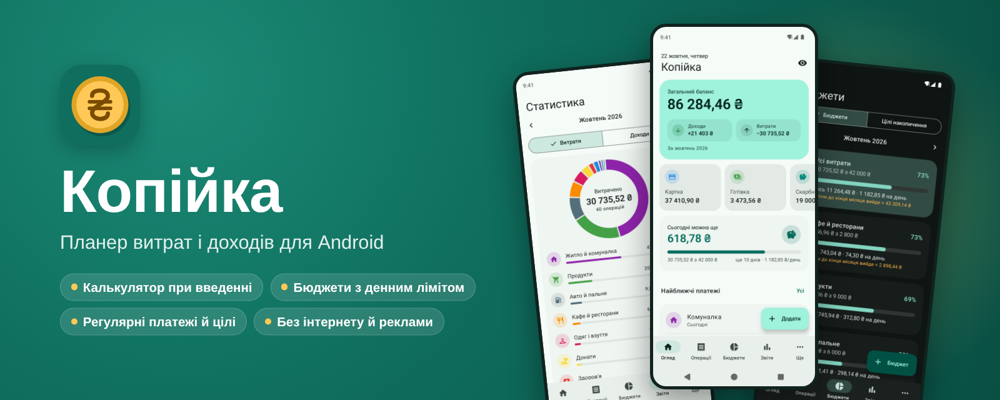
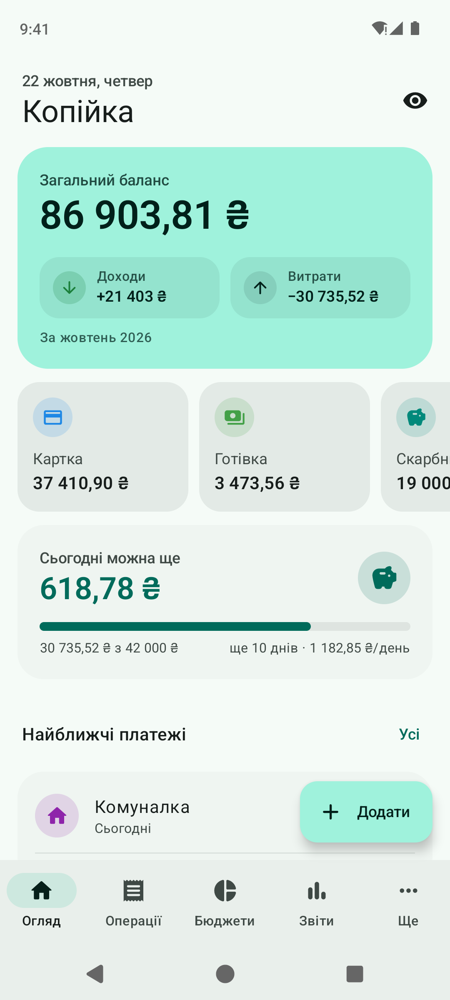
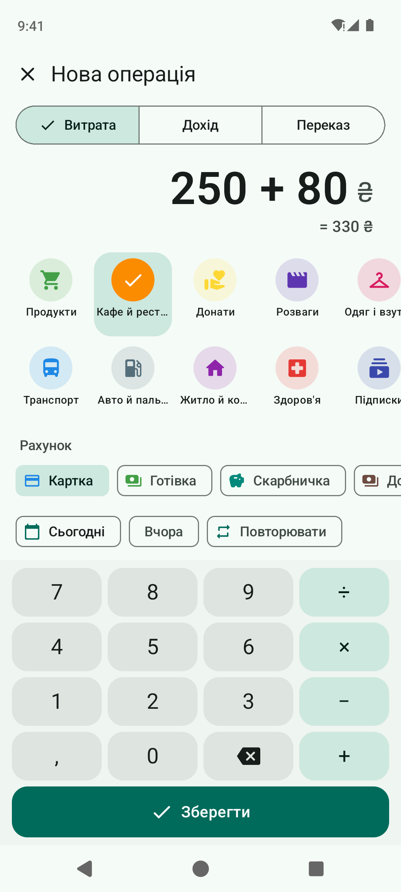
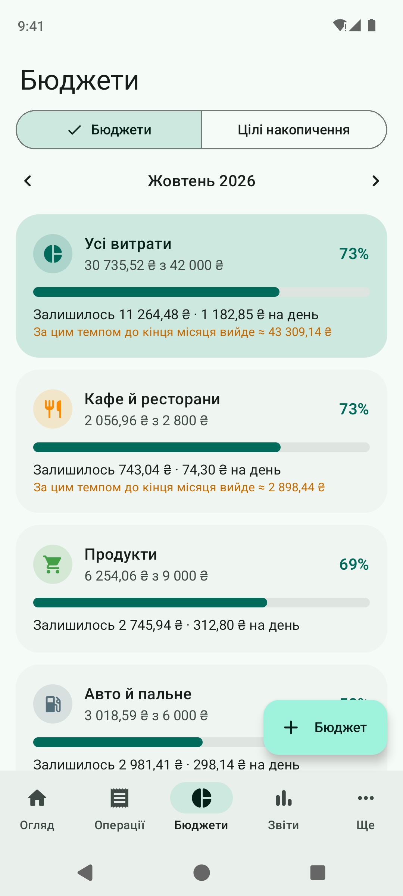
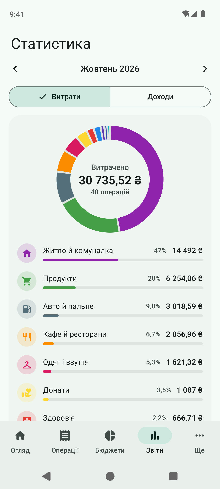
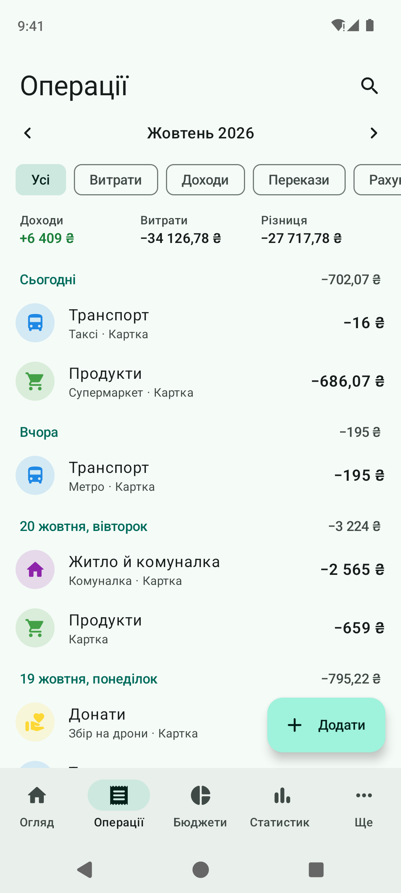
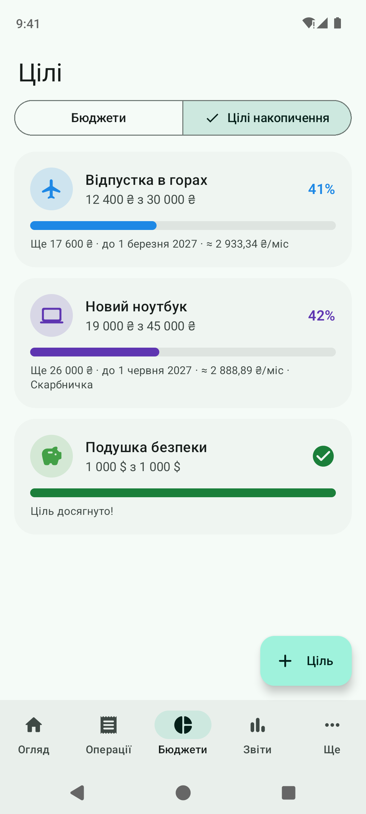
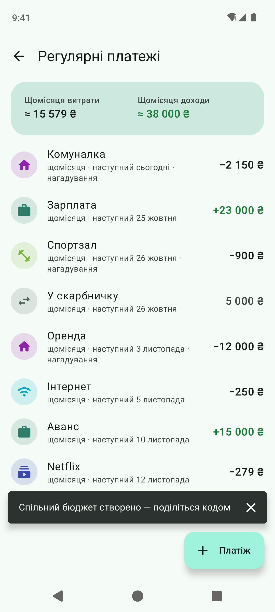
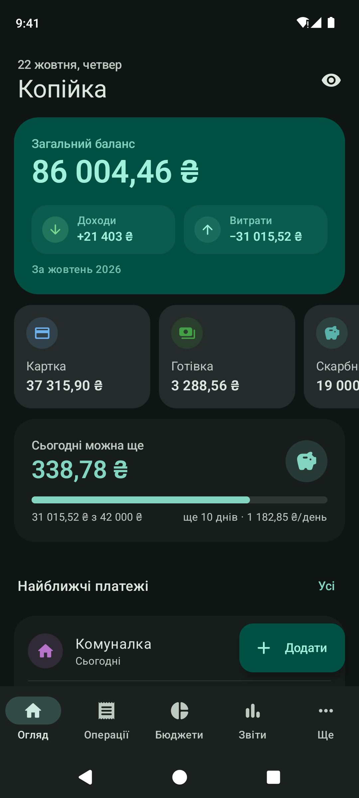

<p align="center">
  
</p>

<p align="center">
  <a href="https://github.com/hatogg/Kopiyka/releases/latest"></a>
  <a href="https://github.com/hatogg/Kopiyka/actions/workflows/build.yml"></a>
  
  
  <a href="LICENSE"></a>
</p>

<p align="center"><b>Українська</b> &nbsp;|&nbsp; <a href="README.en.md">English</a></p>

**Копійка** — планер витрат і доходів для Android. Записуйте витрату за три дотики, тримайте гроші на кількох рахунках і в різних валютах, задайте бюджет на місяць — і Копійка щодня підкаже, скільки ще можна витратити. Регулярні платежі записуються самі, цілі показують, скільки відкладати, а графіки — куди насправді йдуть гроші. Без реклами, без реєстрації, без інтернету.

<p align="center">
  <a href="https://github.com/hatogg/Kopiyka/releases/latest"></a>
</p>

<p align="center">
  
  
  
  
</p>
<p align="center">
  
  
  
  
</p>

<sub>Справжні скриншоти: GitHub Actions запускає застосунок в емуляторі Android 14 і проходить екрани з демо-даними.</sub>

## Можливості

| | |
| --- | --- |
| ⚡ **Швидке введення** | Велика клавіатура-калькулятор: «250+80» одразу дає 330. Категорії, якими ви користуєтесь частіше, — першими. Дата, рахунок, нотатка — за один дотик. |
| 💳 **Рахунки й валюти** | Картки, готівка, «банка», депозит — у гривнях, доларах, євро, злотих та інших. Перекази між рахунками, зокрема з обміном валют. Загальний баланс — в основній валюті. |
| 🎯 **Бюджети** | Загальний ліміт на місяць і окремі — на продукти, кафе, розваги. «Сьогодні можна ще 640 ₴», прогноз до кінця місяця й сповіщення на 80 % і 100 %. Місяць можна починати з дня зарплати. |
| 🔁 **Регулярні платежі** | Оренда, комуналка, підписки, зарплата: щодня, щотижня, щомісяця, щороку чи кожні N. Записуються самі або нагадують — і ви натискаєте «Сплатити». |
| 🐷 **Цілі накопичення** | Відпустка, ноутбук, «подушка безпеки»: прогрес, дедлайн і скільки відкладати щомісяця. Ціль можна прив'язати до рахунку-скарбнички. |
| 📊 **Статистика** | Кільцева діаграма категорій, доходи й витрати за пів року, темп витрат порівняно з минулим місяцем, середнє за день, найбільша витрата. |
| 🔎 **Історія** | Операції по днях із підсумком, пошук за нотаткою, категорією чи сумою, фільтри за типом і рахунком. Змахніть вліво, щоб видалити, — і «Скасувати», якщо випадково. |
| 💾 **Копія й експорт** | Резервна копія в один файл (на Google Диск чи у «Файли») і відновлення з неї. Експорт у CSV для Excel чи Google Таблиць. |
| 📱 **Віджет і ярлики** | Віджет із балансом, витратами за сьогодні й кнопками «− Витрата» / «+ Дохід». Довге натискання на іконку — одразу до нової витрати. |
| 🎨 **Material You** | Кольори під шпалери на Android 12+, світла й темна тема, режим «приховати суми». Українська або англійська — за мовою телефона. |

## Встановлення

1. На телефоні відкрийте [останній реліз](https://github.com/hatogg/Kopiyka/releases/latest) і завантажте `Kopiyka-<версія>.apk`.
2. Відкрийте завантажений файл. Android попросить дозволити встановлення з браузера чи файлового менеджера — дозвольте.
3. **Встановити** → **Відкрити**.

Потрібен Android 8.0 або новіший. Нові версії ставляться поверх старої, дані зберігаються.

**Віджет:** довго натисніть на головному екрані → **Віджети** → **Копійка** → «Копійка: баланс».

## Як почати

1. **Ще → Рахунки** — перейменуйте «Картку» й «Готівку» під себе, вкажіть, скільки на них зараз, додайте інші (валютні теж).
2. **Бюджети → Бюджет** — задайте загальний ліміт на місяць. Якщо зарплата приходить, скажімо, 25-го, у **Ще → Початок місяця** оберіть 25.
3. **Ще → Регулярні платежі** — додайте оренду, підписки, зарплату, щоб вони записувались самі.
4. Далі просто натискайте **Додати** після кожної покупки — або кнопку на віджеті.

## Приватність

Застосунок **не має дозволу на інтернет** — нічого не надсилає і не показує реклами. Курси валют ви вказуєте самі. Усі дані лежать в одному файлі в пам'яті застосунку на телефоні; вийти за його межі вони можуть лише як резервна копія — та, яку зберегли ви, або системна копія Android, якщо вона у вас увімкнена.

## Для розробників

Kotlin, Jetpack Compose, Material 3, Glance (віджет), WorkManager, kotlinx.serialization. Без бази даних і сторонніх сервісів.

```
app/src/main/java/ua/x44to/kopiyka/
├── MainActivity.kt        ← вкладки Огляд · Операції · Бюджети · Звіти · Ще, екрани поверх них
├── data/
│   ├── Models.kt          ← Account, Category, Tx, Budget, Recurring, Goal, Settings
│   ├── Store.kt           ← дані в JSON-файлі, усі зміни, регулярні платежі, копія, CSV
│   ├── Calc.kt            ← періоди, залишки, бюджети, ряди для графіків
│   ├── Money.kt           ← суми в копійках, валюти, формат, калькулятор
│   └── Strings.kt         ← дати й відмінки українською та англійською
├── ui/                    ← екрани, клавіатура-калькулятор, графіки на Canvas, тема
├── widget/                ← віджет балансу (Glance)
└── work/                  ← щоденна перевірка регулярних платежів і сповіщення
```

- **Збірка:** Android Studio або `./gradlew assembleRelease` (JDK 17, Android SDK 35).
- **GitHub Actions** ([build.yml](.github/workflows/build.yml)) збирає APK на кожен push у `main`, перевіряє, що в ньому немає дозволу на інтернет, і викладає його в реліз `v<versionName>`.
- **Скриншоти** ([screenshots.yml](.github/workflows/screenshots.yml)) знімає емулятор Android 14 (Pixel 7): тест проходить екрани українською й англійською, у світлій і темній темі, і комітить PNG у `docs/screens`.
- **Підпис:** ключ `signing/kopiyka.jks` лежить у репозиторії, щоб кожна збірка ставилася поверх попередньої. Для Google Play замініть його своїм і передайте паролі секретами `KP_STORE_PASS` / `KP_KEY_PASS`.

## Ліцензія

[MIT](LICENSE) © x44to
